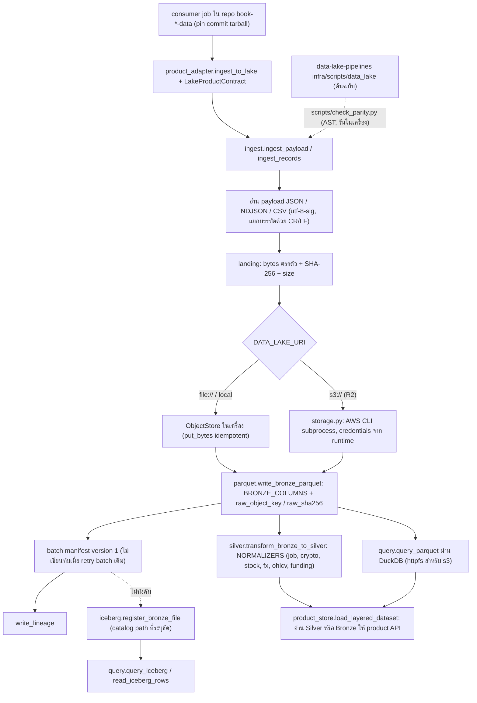
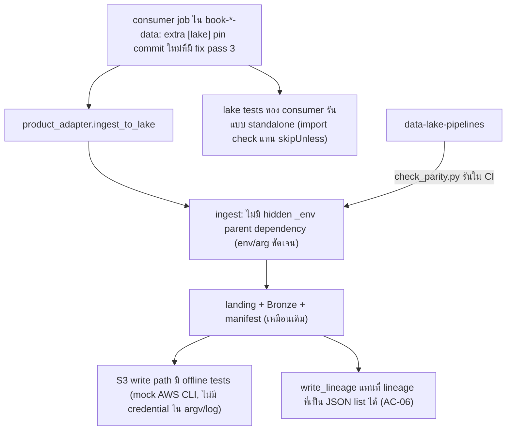

# 01 — Business process (As-Is / To-Be)

data-lake-core (`solo-empire-data-lake`) คือ Python library สาธารณะที่ repo ข้อมูล `book-*-data` ติดตั้งแบบ pin commit เพื่อเก็บข้อมูลต้นทางแบบ lake-first เหมือนกันทุกตัว: เก็บ bytes ต้นทางตรงตัว + SHA-256 → Bronze Parquet → manifest และ lineage → Silver → อ่านด้วย DuckDB ไม่มี API, scraper, credentials หรือ scheduler ของตัวเอง

Last reviewed: 2026-11-28 · commit `cf04838`

## As-Is (จากโค้ดวันนี้)

Sources: `src/data_lake/product_adapter.py` (`ingest_to_lake`, `write_lineage`, `read_bronze_rows`, `read_iceberg_rows`), `src/data_lake/ingest.py`, `src/data_lake/storage.py`, `src/data_lake/parquet.py`, `src/data_lake/silver.py`, `src/data_lake/query.py`, `src/data_lake/iceberg.py`, `src/data_lake/product_store.py`, `scripts/check_parity.py`, `README.md`, `PRODUCT.md`

ข้อเท็จจริงสำคัญจากโค้ด:

- ไม่มี `[project.scripts]`, workflow หรือ cron ใน repo นี้ที่รัน module CLI; ผู้ที่ schedule คือ consumer (Windows tasks ของ consumer [ต้องยืนยัน] ตาม `PRODUCT.md`)
- consumer ที่ pin ไว้ (2026-10-22) ทั้งหมดอยู่ที่ `b8f8698`; สอง product ถูก retire 2026-10-23 รอ archive
- `write_lineage` crash เมื่อไฟล์ lineage เป็น JSON ที่ไม่ใช่ object (pin เป็น `expectedFailure` ใน `tests/test_lake_contract.py`)
- `ingest.py` ยังลอง `from _env import PROJECT_ROOT` ก่อน fallback เป็น path ของ package

## To-Be (docs/UPGRADE-PLAN.md §Backlog; specs/001-l2-baseline/spec.md, status: in review)

To-Be ที่เขียนไว้เป็นงานปรับปรุงกระบวนการเดิม ไม่ใช่กระบวนการใหม่:

Sources: `docs/UPGRADE-PLAN.md` §Backlog P1–P2, `specs/001-l2-baseline/spec.md` (Behaviour, Acceptance AC-06 ถึง AC-09)

## Gap

| ID | As-Is → To-Be | Status | Owner | Evidence |
|---|---|---|---|---|
| G1 | consumer ใช้ `skipUnless` ตาม parent checkout → extra `[lake]` ที่ pin + import check, รัน standalone | todo | claude | `docs/UPGRADE-PLAN.md` §Backlog P1 |
| G2 | parity check รันในเครื่องเท่านั้น → รันใน CI (ต้องมี read token ของ parent repo) | blocked | owner | `docs/UPGRADE-PLAN.md` §Backlog P1; `.github/workflows/ci.yml` |
| G3 | S3 write path (AWS CLI) ไม่มี offline test → mock subprocess และยืนยันไม่มี credential ใน argv/log | todo | claude | `docs/UPGRADE-PLAN.md` §Backlog P1; `src/data_lake/storage.py` |
| G4 | consumer pin `b8f8698` → bump pin ให้ได้ fix pass 3 | todo | claude | `docs/UPGRADE-PLAN.md` §Backlog P1; `PRODUCT.md` §Runtime status |
| G5 | `ingest.py` ลอง `from _env import PROJECT_ROOT` → env/arg ที่ชัดเจน | todo | claude | `docs/UPGRADE-PLAN.md` §Backlog P2; `src/data_lake/ingest.py` |
| G6 | ไม่มี type check → mypy (gradual) ใน CI | done | claude | `specs/001-l2-baseline/spec.md` Behaviour 2; `.github/workflows/ci.yml` |
| G7 | `write_lineage` crash เมื่อ lineage เป็น JSON list → แทนที่ไฟล์ได้ (fix ที่ parent ก่อนแล้ว port) | todo | claude | `specs/001-l2-baseline/spec.md` AC-06; `tests/test_lake_contract.py` `expectedFailure` |
| G8 | SPEC-001 status in review, checker/approver pending → owner อนุมัติ | decide | owner | `specs/001-l2-baseline/spec.md` Document control |
| G9 | repo ของ product ที่ retire (tech-ai-tools-data, travel-flight-price-data) ยัง pin อยู่ → archive | todo | owner | `PRODUCT.md` §Runtime status (Consumers) |

## Open questions

- ผล live parity กับ `data-lake-pipelines` ณ commit นี้ [ต้องยืนยัน] (ตรวจล่าสุด 2026-10-22, ไม่ได้รันในการรีวิวนี้)
- consumer ตัวไหน bump pin ไปแล้วหลัง 2026-10-22 [ต้องยืนยัน]
